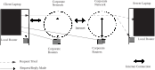
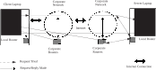

# IDL Tags and Exceptions (normative)

## Overview

This annex lists the standardized profile, service, component, policy tags and exception codes described in the CORBA documentation. Implementor-defined tags can also be registered in this manual. Requests to register tags with the OMG should be sent to *<tag_request@omg.org>*.

## Profile ID Tags

| **Tag Name** | **Tag Value**| **Described in**|
|---------|----------|--------------------|
| ProfileId| TAG_INTERNET_IOP = 0| *Part 2 of this International Standard - Orb Interoperability Architecture Clause* |
| ProfileId| TAG_MULTIPLE_COMPONENTS = 1 | *Part 2 of this International Standard - Orb Interoperability Architecture Clause* |
| ProfileId| TAG_SCCP_IOP = 2| CORBA/TC Interworking specification|
| ProfileId| TAG_UIPMC = 3| *Part 2 of this International Standard -*  *Unreliable Multicast* clause|
| ProfileId| TAG_MOBILE_TERMINAL_IOP = 4 | Telecom Wireless specification                                                     |

## Service ID Tags

| **Tag Name** | **Tag Value**| **Described in**|
|--------------|--------------|------------------|
| ServiceId    | TransactionService = 0| Object Transaction Service specification|
| ServiceId| CodeSets = 1| *Part 2 of this International Standard - ORB Interoperability Architecture* clause.|
| ServiceId| ChainBypassCheck = 2| *Interoperability with non-CORBA Systems* clause:  see *Part 2 of this International Standard*  |
| ServiceId    | ChainBypassInfo = 3| *Interoperability with non-CORBA Systems* clause:  see *Part 2 of this International Standard*. |
| ServiceId| LogicalThreadId = 4| *Interoperability with non-CORBA Systems* clause:  see *Part 2 of this International Standard*  |
| ServiceId| BI_DIR_IIOP = 5| *Part 2 of this International Standard - General Inter-ORB Protocol* clause.|
| ServiceId| SendingContextRunTime = 6     | *This Part of this International Standard - Value Type Semantics* clause.|
| ServiceId| INVOCATION_POLICIES = 7| *This Part of this International Standard - CORBA Messaging* clause.|
| ServiceId| FORWARDED_IDENTITY = 8| Firewall Traversal specification (ptc/04-03-01)|
| ServiceId| UnknownExceptionInfo = 9| Java to IDL Language Mapping specification:|
| ServiceId| RTCorbaPriority = 10| Real-Time CORBA specification: see|
| ServiceId| RTCorbaPriorityRange = 11     | Real-Time CORBA specification: see|
| ServiceId| FT_GROUP_VERSION = 12| *Fault Tolerant CORBA* clause: see CORBA, v3.0.3.|
| ServiceId| FT_REQUEST= 13| *Fault Tolerant CORBA* clause: see CORBA, v3.0.3.|
| ServiceId| ExceptionDetailMessage = 14   | *Part 2 of this International Standard - ORB Interoperability Architecture* clause.|
| ServiceId| SecurityAttributeService = 15 | *Part 2 of this International Standard - Secure Interoperability* clause.|
| ServiceId| ActivityService = 16| Additional Structuring Mechanisms for the OTS.|
| ServiceId| RMICustomMaxStreamFormat = 17 | Java to IDL Language Mapping specification.|
| ServiceId| ACCESS_SESSION_ID = 18| Telecom Service Access Subscription (TSAS) specification.                                       |
| ServiceId| SERVICE_SESSION_ID = 19| Telecom Service Access Subscription (TSAS) specification.|
| ServiceId| FIREWALL_PATH = 20| Firewall Traversal specification (ptc/04-03-01)                                                 |
| ServiceId| FIREWALL_PATH_RESP = 21       | Firewall Traversal specification (ptc/04-03-01)|

## Component ID Tags

| **Tag Name** | **Tag Value**| **Described in**|
|--------------|--------------|------------------|
| ComponentId  | TAG_ORB_TYPE = 0                      | *CORBA 3.1, Part 2 - ORB Interoperability Architecture* clause.|
| ComponentId  | TAG_CODE_SETS = 1                     | *CORBA 3.1, Part 2 - ORB Interoperability Architecture* clause.|
| ComponentId  | TAG_POLICIES = 2| *CORBA 3.1, Part 1 - CORBA Messaging* clause.|
| ComponentId  | TAG_ALTERNATE_IIOP_ADDRESS = 3        | *CORBA 3.1, Part 2 - General Inter-ORB Protocol* clause.|
| ComponentId  | TAG_COMPLETE_OBJECT_KEY = 5| *The DCE ESIOP* clause: see CORBA, v3.0.3.|| ComponentId  | TAG_ENDPOINT_ID_POSITION = 6          | *The DCE ESIOP* clause: see CORBA, v3.0.3.|
| ComponentId  | TAG_LOCATION_POLICY = 12| *The DCE ESIOP* clause: see CORBA, v3.0.3.|
| ComponentId  | TAG_ASSOCIATION_OPTIONS =13| Security Service specification.|
| ComponentId  | TAG_SEC_NAME = 14||
| ComponentId  | TAG_SPKM_1_SEC_MECH = 15||
| ComponentId  | TAG_SPKM_2_SEC_MECH = 16||
| ComponentId  | TAG_KerberosV5_SEC_MECH = 17||
| ComponentId  | TAG_CSI_ECMA_Secret_SEC_MECH = 18     ||
| ComponentId  | TAG_CSI_ECMA_Hybrid_SEC_MECH = 19     ||
| ComponentId  | TAG_SSL_SEC_TRANS = 20||
| ComponentId  | TAG_CSI_ECMA_Public_SEC_MECH = 21     ||
| ComponentId  | TAG_GENERIC_SEC_MECH = 22||
| ComponentId  | TAG_FIREWALL_TRANS = 23| Firewall Traversal specification (ptc/04-03-01)|
| ComponentId  | TAG_SCCP_CONTACT_INFO = 24            | CORBA/TC Interworking and SCCP Inter-ORB Protocol specification.|
| ComponentId  | TAG_JAVA_CODEBASE = 25| Java to IDL Language Mapping specification.|
| ComponentId  | TAG_TRANSACTION_POLICY = 26           | Object Transaction Service specification.|
| ComponentId  | TAG FT_GROUP= 27| *Fault Tolerant CORBA* clause: see CORBA, v3.0.3.|
| ComponentId  | TAG_ FT_PRIMARY= 28                  | *Fault Tolerant CORBA* clause: see CORBA, v3.0.3.|
| ComponentId  | TAG_ FT_HEARTBEAT_ENABLED = 29       | *Fault Tolerant CORBA* clause: see CORBA, v3.0.3.|
| ComponentId  | TAG_MESSAGE_ROUTERS = 30| *This Part of this International Standard - CORBA Messaging* clause.|
| ComponentId  | TAG_OTS_POLICY = 31| Object Transaction Service specification.|
| ComponentId  | TAG_INV_POLICY = 32| Object Transaction Service specification.|
| ComponentId  | TAG_CSI_SEC_MECH_LIST = 33            | *Part 2 of this International Standard - Secure*  *Interoperability* clause |
| ComponentId  | TAG_NULL_TAG = 34| *Part 2 of this International Standard - Secure*  *Interoperability* clause |
| ComponentId  | TAG_SECIOP_SEC_TRANS = 35| *Part 2 of this International Standard - Secure*  *Interoperability* clause |
| ComponentId  | TAG_TLS_SEC_TRANS = 36| *Part 2 of this International Standard - Secure*  *Interoperability* clause |
| ComponentId  | TAG_ACTIVITY_POLICY = 37| Additional Structuring Mechanisms for the OTS.|
| ComponentId  | TAG_RMI_CUSTOM_MAX_STREAM_FORMAT = 38 | Java to IDL Language Mapping specification.|
| ComponentId  | TAG_GROUP = 39| *Part 2 of this International Standard - Unreliable Multicast* clause       |
| ComponentId  | TAG_GROUP_IIOP = 40| *Part 2 of this International Standard - Unreliable Multicast* clause       |
| ComponentId  | TAG_PASSTHRU_TRANS = 41| Firewall Traversal (ptc/04-03-01)|
| ComponentId  | TAG_FIREWALL_PATH = 42| Firewall Traversal (ptc/04-03-01)|
| ComponentId  | TAG_IIOP_SEC_TRANS = 43               | Firewall Traversal (ptc/04-03-01)|
| ComponentId  | TAG_HOME_LOCATION_INFO = 44           | Telecom Wireless specification.|
| ComponentId  | TAG_DCE_STRING_BINDING = 100          | *The DCE ESIOP* clause: see *Part 2 of this International Standard*|
| ComponentId  | TAG_DCE_BINDING_NAME = 101            | *The DCE ESIOP* clause: see *Part 2 of this International Standard*.|
| ComponentId  | TAG_DCE_NO_PIPES = 102                | *The DCE ESIOP* clause: see *Part 2 of this International Standard*|
| ComponentId  | TAG_DCE_SEC_MECH = 103| Security Service specification.|
| ComponentId  | TAG_INET_SEC_TRANS = 123              | Security Service specification.|

## Policy Type Tags

The table below lists the standard policy types that are defined by various parts of CORBA and CORBA Services in this version of CORBA/IIOP.

| **Policy Type**| **Policy Interface**| **Defined in**| **Uses create _policy** |
|-------------------|------------------|------------------|----|
| SecClientInvocationAccess = 1| SecurityAdmin::AccessPolicy| Security Service specification.| N|
| SecTargetInvocationAccess = 2| SecurityAdmin::AccessPolicy|| N|
| SecApplicationAccess = 3| SecurityAdmin::AccessPolicy|| N|
| SecClientInvocationAudit = 4| SecurityAdmin::AuditPolicy|| N|
| SecTargetInvocationAudit = 5| SecurityAdmin::AuditPolicy|| N|
| SecApplicationAudit = 6| SecurityAdmin::AuditPolicy|| N|
| SecDelegation = 7| SecurityAdmin::Delegation Policy|| N|
| SecClientSecureInvocation = 8| SecurityAdmin::SecureInvocationPolicy|| N|
| SecTargetSecureInvocation = 9| SecurityAdmin::SecureInvocationPolicy|| N|
| SecNonRepudiation = 10| NRService::NRPolicy|| N|
| SecConstruction = 11| CORBA::SecConstruction| *CORBA 3.1, Part 1 - ORB*  *Interface* clause| N|
| SecMechanismPolicy = 12| SecurityLevel2::MechanismPolicy| Security Service specification.| Y|
| SecInvocationCredentialsPolicy = 13 | SecurityLevel2::InvocationCredentials Policy || Y|
| SecFeaturesPolicy = 14| SecurityLevel2::FeaturesPolicy|| Y|
| SecQOPPolicy = 15| SecurityLevel2::QOPPolicy|| Y|
| THREAD_POLICY_ID = 16| PortableServer::ThreadPolicy| *CORBA 3.1, Part 1 - Portable Object Adapter* clause | Y|
| LIFESPAN_POLICY_ID = 17| PortableServer::LifespanPolicy|| Y|
| ID_UNIQUENESS_POLICY_ID = 18| PortableServer::IdUniquenessPolicy|| Y|
| ID_ASSIGNMENT_POLICY_ID = 19| PortableServer::IdAssignmentPolicy|| Y|
| IMPLICIT_ACTIVATION_POLICY_ID = 20  | PortableServer::ImplicitActivationPolicy    || Y|
| SERVENT_RETENTION_POLICY_ID = 21    | PortableServer::ServentRetentionPolicy|| Y|
| REQUEST_PROCESSING_POLICY_ID = 22   | PortableServer::RequestProcessingPolicy|| Y|
| REBIND_POLICY_TYPE = 23| Messaging::RebindPolicy| *CORBA 3.1, Part 1 -*  *CORBA Messaging* clause| Y|
| SYNC_SCOPE_POLICY_TYPE = 24| Messaging::SyncScopePolicy|| Y|
| REQUEST_PRIORITY_POLICY_TYPE = 25| Messaging::RequestPriorityPolicy|| Y|
| REPLY_PRIORITY_POLICY_TYPE = 26| Messaging::ReplyPriorityPolicy|| Y|
| REQUEST_START_TIME_POLICY_TYPE =  27| Messaging::RequestStartTimePolicy|| Y|
| REQUEST_END_TIME_POLICY_TYPE = 28| Messaging::RequestEndTimePolicy|| Y|
| REPLY_START_TIME_POLICY_TYPE = 29| Messaging::ReplyStartTimePolicy|| Y|
| REPLY_END_TIME_POLICY_TYPE = 30| Messaging::ReplyEndTimePolicy|| Y|
| RELATIVE_REQ_TIMEOUT_POLICY_  TYPE = 31| Messaging::RelativeRequestTimeoutPolicy     || Y|
| RELATIVE_RT_TIMEOUT_POLICY_  TYPE = 32| Messaging::RelativeRoundtripTimeout  Policy || Y|
| ROUTING_POLICY_TYPE = 33| Messaging::RoutingPolicy|| Y|
| MAX_HOPS_POLICY_TYPE =34| Messaging::MaxHopsPolicy|| Y|
| QUEUE_ORDER_POLICY_TYPE = 35| Messaging::QueueOrderPolicy|| Y|
| FIREWALL_POLICY_TYPE = 36| Firewall::FirewallPolicy| Firewall Traversal specification: (ptc/04-0301)| Y|
| BIDIRECTIONAL_POLICY_TYPE = 37| BiDirPolicy::BidirectionalPolicy| *Part 2 of this International Standard - General Inter-ORB Protocol* clause | Y|
| SecDelegationDirectivePolicy = 38| SecurityLevel2::DelegtionDirectivePolicy    | Security Service specification.| Y|
| SecEstablishTrustPolicy = 39| SecurityLevel2::EstablishTrustPolicy|| Y|
| PRIORITY_MODEL_POLICY_TYPE = 40| RTCORBA::PriorityModelPolicy| Real-Time CORBA specification.| Y|
| THREADPOOL_POLICY_TYPE = 41| RTCORBA::ThreadpoolPolicy|| Y|
| SERVER_PROTOCOL_POLICY_TYPE = 42| RTCORBA::ServerProtocolPolicy|| Y|
| CLIENT_PROTOCOL_POLICY_TYPE = 43| RTCORBA::ClientProtocolPolicy|| Y|
| PRIVATE_CONNECTION_POLICY_  TYPE = 44| RTCORBA::PrivateConnectionpolicy|| Y|
| PRIORITY_BANDED_CONNECTION_  POLICY_TYPE = 45 | RTCORBA::PriorityBandedConnection  Policy   || Y|
| TransactionPolicyType = 46| CosTransactions::TransactionPolicy| Object Transaction Service specification.| Y|
| REQUEST_DURATION_POLICY_  TYPE = 47|| *Fault Tolerant CORBA*: see CORBA, v3.0.3.||
| HEARTBEAT_POLICY_TYPE = 48|| *Fault Tolerant CORBA*: see CORBA, v3.0.3.||
| HEARTBEAT_ENABLED_POLICY_  TYPE = 49||||
| IMMEDIATE_SUSPEND_POLICY_ TYPE = 50| valuetype MessageRouting:: ImmediateSuspend | *CORBA 3.1, Part 1 -*  *CORBA Messaging* clause| N|
| UNLIMITED_PING_POLICY_TYPE =  51| valuetype  MessageRouting::UnlimitedPing    || N|
| LIMITED_PING_POLICY_TYPE = 52| valuetype MessageRouting::LimitedPing|| N|
| DECAY_POLICY_TYPE = 53| valuetype  MessageRouting::DecayPolicy|| N|
| RESUME_POLICY_TYPE = 54| valuetype  MessageRouting::ResumePolicy|| N|
| INVOCATION_POLICY_TYPE = 55| CosTransactions::InvocationPolicy| Object Transaction Service specification.| Y|
| OTS_POLICY_TYPE = 56| CosTransactions::OTSPolicy|| Y|
| NON_TX_TARGET_POLICY_TYPE =  57| CosTransactions::NonTxTargetPolicy|| Y|
| ActivityPolicyType = 58| CORBA::PolicyType| Additional Structuring  Mechanisms for the OTS.| Y|
| OSA_MANAGER_POLICY = 59|| Security Domain  Membership (orbos/01-06-||
| ODM_MANAGER_POLICY = 60|| 01)||
| PATH_SELECTION_POLICY_TYPE =  61|| Firewall Traversal specification (ptc/04-03-01)||
| PATH_INSERTION_POLICY_TYPE =  62||||
| PROCESSING_MODE_POLICY_TYPE  = 63|| *CORBA 3.1, Part 1 -*  *Portable Interceptor* clause ||
| COMPRESSION_ENABLING_OPOLIC Y_ID = 64| ZIOP::CompressionEnablingPolicy|| Y|
| COMPRESSOR_ID_LEVEL_LIST_POL ICY_ID = 65 | ZIOP::CompressionIdLevelListPolicy|| Y|
| COMPRESSION_LOW_VALUE_POLIC Y_ID = 66    | ZIOP::CompressionLowValuePolicy|| Y|
| COMPRESSION_MIN_RATIO_POLICY _ID = 67   | ZIOP::CompressionMinRatioPolicy|| Y|

## Exception Codes

If an exception that is to be raised for an error condition does not explicitly specify a specific standard minor code for that error condition, implementations can either use a minor code of zero, or use a vendor-specific minor code to convey more detail about the error.

The following table specifies standard minor exception codes that have been assigned for the standard system exceptions. The actual value that is to be found in the **minor** field of the **ex_body** structure is obtained by or-ing the values in this table with the **OMGVMCID** constant. For example “Missing local value implementation” for the exception NO_IMPLEMENT would be denoted by the **minor** value **0x4f4d0001.**

| **SYSTEM EXCEPTION**   | **MINOR CODE** | **EXPLANATION**|
|-------------|----------------|-------------------|
| **ACTIVITY_COMPLETED** | 1| Activity context completed through timeout, or in some way other than requested. |
| **ACTIVITY_REQUIRED**  | 1| Calling thread lacks required activity context.|
| **BAD_CONTEXT**| 1| IDL context not found.|
|| 2| No matching IDL context property.|
| **BAD_INV_ORDER**    | 1| Dependency exists in IFR preventing destruction of this object.|
|| 2| Attempt to destroy indestructible objects in IFR.|
|| 3| Operation would deadlock.|
|| 4| ORB has shutdown|
|| 5| Attempt to invoke **send** or **invoke** operation of the same **Request** object more than once.|
|| 6| Attempt to set a servant manager after one has already been set.|
|| 7| **ServerRequest::arguments** called more than once or after a call to S**erverRequest:: set_exception**.|
|| 8| **ServerRequest::ctx** called more than once or before  **ServerRequest::arguments** or after **ServerRequest::ctx,** **ServerRequest::set_result** or  **ServerRequest::set_exception**. |
|| 9| **ServerRequest::set_result** called more than once or before  **ServerRequest::arguments** or after **ServerRequest::set_result** or  **ServerRequest::set_exception.**|
|| 10| Attempt to send a DII request after it was sent previously.|
|| 11| Attempt to poll a DII request or to retrieve its result before the request was sent.|
|| 12| Attempt to poll a DII request or to retrieve its result after the result was retrieved previously.|
|| 13| Attempt to poll a synchronous DII request or to retrieve results from a synchronous DII request.|
|| 14| Invalid portable interceptor call.|
|| 15| Service context add failed in portable interceptor because a service context with the given id already exists.|
|| 16| Registration of **PolicyFactory** failed because a factory already exists for the given **PolicyType.**
|| 17| **POA** cannot create **POA**s while undergoing destruction|
|| 18| Attempt to reassign priority.|
|| 19| An OTS/XA integration **xa_start** call returned  **XAER_OUTSIDE.**|
|| 20| An OTS/XA integration **xa_** call returned **XAER_PROTO.**|
|| 21| Transaction context of request and client threads do not match in interceptor.|
|| 22| Poller has not returned any response yet.|
|| 23| Registration of TaggedProfileFactory failed because a factory already exists for the given id.   |
|| 24| Registration of TaggedComponentFactory failed because a factory already exists for the given id. |
|| 25| Iteration has no more elements.|
|| 26| Invocation of this operation not allowed in post_init.|
| **BAD_OPERATION**| 1| ServantManager returned wrong servant type.|
|| 2| Operation or attribute not known to target object|
| **BAD_PARAM**| 1| Failure to register, unregister, or lookup value factory.|
|| 2| RID already defined in IFR.|
|| 3| Name already used in the context in IFR.|
|| 4| Target is not a valid container.|
|| 5| Name clash in inherited context.|
|| 6| Incorrect type for abstract interface.|
|| 7| string_to_object conversion failed due to bad scheme name.|
|| 8| string_to_object conversion failed due to bad address.|
|| 9| string_to_object conversion failed due to bad bad schema specific part.|
|| 10| string_to_object conversion failed due to non specific reason.                                      |
|| 11| Attempt to derive abstract interface from non-abstract base interface in the Interface Repository.  |
|| 12| Attempt to let a ValueDef support more than one non-abstract interface in the Interface Repository. |
|| 13| Attempt to use an incomplete **TypeCode** as a parameter.|
|| 14| Invalid object id passed to **POA::create_reference_by_id.**|
|| 15| Bad **name** argument in **TypeCode** operation.|
|| 16| Bad **RepositoryId** argument in **TypeCode** operation.|
|| 17| Invalid member name in **TypeCode** operation.|
|| 18| Duplicate label value in **create_union_tc**.|
|| 19| Incompatible TypeCode of label and discriminator in **create_union_tc**.|
|| 20| Supplied discriminator type illegitimate in **create_union_tc**.|
|| 21| **Any** passed to **ServerRequest::set_exception** does not contain an exception.|
|| 22| Unlisted user exception passed to  **ServerRequest::set_exception**.|
|| 23| wchar transmission code set not in service context.|
|| 24| Service context is not in OMG-defined range.|
|| 25| Enum value out of range.|
|| 26| Invalid service context Id in portable interceptor.|
|| 27| Attempt to call **register_initial_reference** with a null **Object.**|
|| 28| Invalid component Id in portable interceptor.|
|| 29| Invalid profile Id in portable interceptor.|
|| 30| Two or more **Policy** objects with the same **PolicyType** value  supplied to **Object::set_policy_overrides** or **PolicyManager::set_policy_overrides**. |
|| 31| Attempt to define a **oneway** operation with non-void result, **out** or **inout** parameters or user exceptions.|
|| 32| DII asked to create request for an implicit operation.|
|| 33| An OTS/XA integration **xa_** call returned **XAER_INVAL**.|
|| 34| Union branch modifier called with bad case label discriminator.|
|| 35| Illegal IDL context property name.|
|| 36| Illegal IDL property search string.|
|| 37| Illegal IDL context name.|
|| 38| Non-empty IDL context.|
|| 39| Unsupported RMI/IDL custom value type stream format.|
|| 40| ORB output stream does not support ValueOutputStream interface.|
|| 41| ORB input stream does not support ValueInputStream interface.|
|| 42| Character support limited to ISO 8859-1 for this object reference.|
|| 43| Attempt to add a Pollable to a second PollableSet.|
| **BAD_TYPECODE**| 1| Attempt to marshal incomplete **TypeCode.**|
|| 2| Member type code illegitimate in **TypeCode** operation.|
|| 3| Illegal parameter type.|
| **CODESET_INCOMPATIBLE** | 1| Codeset negotiation failed.|
|| 2| Codeset delivered in CodeSetContext is not supported by server as transmission codeset.|
| **DATA_CONVERSION**| 1| Character does not map to negotiated transmission code set.|
|| 2| Failure of **PriorityMapping** object.|
| **IMP_LIMIT**| 1| Unable to use any profile in IOR.|
| **INITIALIZE**| 1| Priority range too restricted for ORB.|
| **INTERNAL**| 1| An OTS/XA integration **xa_** call returned **XAER_RMERR**.|
|| 2| An OTS/XA integration **xa_** call returned **XAER_RMFAIL**.|
| **INTF_REPOS**| 1| Interface Repository not available|
|| 2| No entry for requested interface in Interface Repository|
| **INVALID_ACTIVITY**| 1| Transaction or Activity resumed in wrong context, or invocation incompatible with Activity’s current state.|
| **INV_OBJREF**| 1| wchar Code Set support not specified.|
|| 2| Codeset component required for type using **wchar** or **wstring** data|
| **INV_POLICY**| 1| Unable to reconcile IOR specified policy with effective policy override.|
|| 2| Invalid **PolicyType.**|
|| 3| No **PolicyFactory** has been registered for the given **PolicyType**.|
| **MARSHAL**| 1| Unable to locate value factory.|
|| 2| **ServerRequest::set_result** called before **ServerRequest::ctx** when the operation IDL contains a context clause.  |
|| 3| **NVList** passed to **ServerRequest::arguments** does not describe all parameters passed by client.|
|| 4| Attempt to marshal **Local** object.|
|| 5| **wchar** or **wstring** data erroneosly sent by client over **GIOP** 1.0 connection|
|| 6| **wchar** or **wstring** data erroneously returned by server over **GIOP** 1.0 connection.|
|| 7| Unsupported RMI/IDL custom value type stream format.|
| **NO_IMPLEMENT**| 1| Missing local value implementation.|
|| 2| Incompatible value implementation version.|
|| 3| Unable to use any profile in IOR.|
|| 4| Attempt to use DII on Local object.|
|| 5| Biomolecular Sequence Analysis iterator cannot be reset.|
|| 6| Biomolecular Sequence Analysis metadata is not available as  XML.|
|| 7| Genomic Maps iterator cannot be rest.|
|| 8| Operation not implemented in local object.|
| **NO_RESOURCES**| 1| Portable Interceptor operation not supported in this binding.|
|| 2| No connection for request’s priority.|
| **NO_RESPONSE**| 1| Reply is not available immediately in a non-blocking call.|
| **OBJ_ADAPTER**| 1| System exception in **AdapterActivator::unknown_adapter**.|
|| 2| Incorrect servant type returned by servant manager.|
|| 3| No default servant available [POA policy].|
|| 4| No servant manager available [POA Policy].|
|| 5| Violation of POA policy by **ServantActivator::incarnate.**|
|| 6| Exception in  **PortableInterceptor::**IORInterceptor.components_established.|
|| 7| Null servant returned by servant manager|
| **OBJECT_NOT_EXIST**| 1| Attempt to pass an unactivated (unregistered) value as an object reference.|
|| 2| Failed to create or locate Object Adapter.|
|| 3| Biomolecular Sequence Analysis Service is no longer available.|
|| 4| Object Adapter inactive.|
|| 5| This Poller has already delivered a reply to some client.|
| **TIMEOUT**| 1| Reply is not available in the Poller by the timeout set for it.|
|| 2| End time specified in RequestEndTimePolicy or RelativeRequestTimeoutPolicy has expired.|
|| 3| End time specified in ReplyEndTimePolicy or RelativeReplyTimeoutPolicy has expired.|
| **TRANSACTION_ROLLEDBACK** | 1              | An OTS/XA integration **xa_** call returned **XAER_RB**.|
|| 2| An OTS/XA integration **xa_** call returned **XAER_NOTA**.|
|| 3| OTS/XA integration **end** was called with success set to **TRUE** while transaction rollback was deferred.|
|| 4| Deferred transaction rolled back.|
| **TRANSIENT**| 1| Request discarded because of resource exhaustion in **POA**, or because POA is in discarding state.|
|| 2| No usable profile in IOR.|
|| 3| Request cancelled.|
|| 4| **POA** destroyed.|
| **UNKNOWN**| 1| Unlisted user exception received by client.|
|| 2| Non-standard System Exception not supported.|
|| 3| An unknown user exception received by a portable interceptor.|

## Identity Tokens

The following identity tokens are defined in the Security Context clause (*Part 2 of this International Standard*) and the Firewall Traversal specification (ptc/04-03-01). These tokens must be powers of two.

- ITTAbsent = 0;
- ITTAnonymous = 1;
- ITTPrincipalName = 2;
- ITTX509CertChain = 4;
- ITTDistinguishedName = 8;
- ITTCompoundToken = 16;

# CORBA Messaging: Overall Design Rationale (normative)

## QoS Abstract Model Design

This Annex describes each of the components in the Quality of Service (QoS) abstract model and their relationships. The specification defines a framework within which current QoS levels are queried and overridden. This framework is intended to be of use for CORBAServices specifiers, as well as for future revisions of CORBA. The Messaging-specific QoS are defined in terms of this framework.

**NOTE:** The QoS definitions specified in this specification are applied to both synchronous as well as asynchronous invocations.

## Model Components

The QoS framework abstract model consists of the following components:

- **Policy** - The base interface from which all QoS objects derive.
- **PolicyList** - A sequence of Policy objects.
- **PolicyManager** - An interface with operations for querying and overriding QoS **Policy** settings.
- Mechanisms for obtaining **Policy** override management operations at each relevant application scope:
- The ORB’s **PolicyManager** is obtained through invoking **ORB::resolve_initial_references** with the **ObjectId** “ORBPolicyManager”.
- A **CORBA::PolicyCurrent** derived from **CORBA::Current** is used for managing the thread’s QoS Policies. A reference to this interface is obtained through an invocation of **ORB::resolve_initial_references** with the **ObjectId** “PolicyCurrent.”
- Accessor operations on **CORBA::Object** allow querying and overriding of QoS at the object reference scope.
- The application of QoS on a Portable Object Adapter is done through the currently existing mechanism of passing a **PolicyList** to the **POA::create_POA** operation.
- Mechanisms for transporting Policy values as part of interoperable object references and within requests:
- **TAG_POLICIES** - A Profile Component containing the sequence of QoS policies exported with the object reference by an object adapter.
- **INVOCATION_POLICIES** - A Service Context containing a sequence of QoS policies in effect for the invocation.

The Messaging QoS abstract model consists of a number of **CORBA::Policy**-derived interfaces:

- Client-side Policies are applied to control the behavior of requests and replies. These include Priority, RequestEndTime, and Queueing QoS.
- Server-side Policies are applied to control the default behavior of invocations on a target. These include QueueOrder and Transactionality QoS.

### Component Relationships

Programmers set QoS at various levels of scope by creating a Policy-derived Messaging QoS Policy and selecting the interface for the particular scope. It is anticipated that the following is the standard use-case scenario:

- A POA is created with a certain set of QoS. When object references are created by that POA, the required and supported QoS are encoded in that object reference. Such an object reference is then exported for use by a client.
- Within a client, the ORB’s **PolicyManager** interface is obtained to set QoS for the entire ORB (for the entire process when only one ORB is present) either programmatically, or administratively. The Policies set here are valid for all invocations in the process. A programmer-constructed **PolicyList** is used with this interface to actually set the QoS.
- Within that same client, the **CORBA::PolicyCurrent** is obtained to set QoS for all invocations in the current thread. This interface is derived from the **PolicyManager** interface, which can be used to change the QoS for each invocation. A programmer-constructed **PolicyList** is used with this interface to actually set the QoS.
- Within that same client, the object reference is obtained and an invocation of its **get_client_policy** operation queries the most specific QoS overrides. A programmer-constructed **PolicyList** may be passed to the Object’s
**set_policy_overrides** operation to obtain a new Object reference with revised QoS. Setting the QoS here applies to all invocations using the new Object reference and supersedes (if possible) those set at the ORB and thread (Current) scopes. The current set of overrides can be validated by calling the Object’s pseudo-operation **validate_connection**, which will attempt to locate a target for the object reference if no target has yet been located. At this time, any Policy overrides placed at the Object, Thread or ORB scope will be reconciled with the QoS Policies established for that object reference when it was created by the POA. The current *effective* **Policy** can then be queried by invoking **get_policy**, which returns the **Policy** value that is in effect.

- Unseen by the application, the ORB (including the protocol engine) modifies its internal behavior in order to realize the quality of service indicated by the client through the first three steps. See the description of the protocol abstract design in [Message Routing Abstract Model Design](#message-routing-abstract-model-design).

### Component Design

Design decisions were made with respect to the following components of the QoS framework:

- Each QoS is an interface derived from **CORBA::Policy**. The design trade-offs focused on ease of application interface for setting specific QoS values, extensibility for new QoS types and values, and compactness so the QoS values can be represented efficiently in Service Contexts and IOR Profile Components. Several alternatives were considered as the basic type for each QoS entity before the decision was made to use the **Policy** interface:
- **CORBA::NamedValue** - A pair of **string** and **any** were considered mainly due to the flexibility afforded by using an any to represent QoS values. This design was discounted due to the untyped nature of the **any** and the application development and execution costs of inserting typed data into and extracting typed data from values of type **any**. Furthermore, the presence of a full typecode within an any makes the size of such pairs too large for inclusion in compact Service Contexts and Profile Components.
- Stateful CORBA **valuetype** - Although the **valuetype** does present a typed interface to the application program, including **valuetype**s in Service Contexts and IOR Profile Components is too expensive due to the presence of full repository identifier information when the **valuetype** is marshaled. Furthermore, there are issues associated with potential truncation of such QoS **valuetype**s when passed as formal arguments of their base type.
- Interfaces derived from **CORBA::Policy** and compact representation. In the model chosen by this specification, the QoS values are accessible through locality-constrained interfaces. Derivation from **CORBA::Policy** allows reuse of existing interfaces and operations for policy management. When certain QoS values must be marshaled in a Service Context or an IOR Profile Component, the most compact format was chosen. The type of QoS **Policy** represented is indicated by a structure containing the integral **PolicyType** and a **sequence** of **octet** holding the values for that policy.
- A generic factory for creating QoS Policies. In the *POA* specification within *CORBA*, each POA **Policy** is created through an operation on the POA itself. Although this presents a convenient typed interface for the creation of **Policy** objects, it causes serious problems when new POA Policies are introduced. To fit with the current model, operations would have to be added to the POA interface for every new type of POA **Policy**. To address this potential administrative nightmare, this specification introduces a new ORB operation **create_policy**. Rather than introducing typed operations for creating all of the Messaging QoS Policies discussed in this specification, the generic factory operation is used.
- A **RebindPolicy** client-side QoS **Policy** to ensure deterministic effective QoS. In *CORBA*, *transparent rebinding* of an object reference may take place during any invocation. Rebinding is defined here to mean changing the clientvisible QoS as a result of replacing the IOR Profile used by a client’s object reference with a new IOR Profile. Transparent rebinding is defined as when this happens without notice to the client application. Typically, this happens within GIOP through the use of location forwarding. The default **RebindPolicy** (and the only *CORBA* behavior) supports this transparent rebind. For an application with rigorous quality of service requirements, such transparent rebinding can cause problems. For instance, unexpected errors may occur if the application sets its QoS Policies appropriately for an object reference, and then the ORB transparently changes the application’s assumptions about that reference by obtaining a new IOR. The **RebindPolicy** has been added so that applications can prevent the ORB from silently changing the IOR Profile (and therefore the server-side QoS) that have been assumed. A more rigorous value of this **Policy** even precludes the ORB from silently closing and opening connections (when IIOP is being used, for example). The specific requirements demanded by an application dictate which level of **RebindPolicy** is necessary.

## AMI/TII Abstract Model Design

This sub clause describes each of the components in the Asynchronous Method Invocation /Time-Independent Invocation (AMI/TII) abstract model and the relationships between them.

The model supported by Messaging is a specialization of the general object model described in the OMA guide. All of the elements of the CORBA object model are present in the model described here. Some of the names of existing components are defined more precisely than they are in the CORBA object model. In addition, this specification adds some new components to support Messaging.

Some of the components described here have been borrowed from other specifications, which in some cases have yet to be ratified. Where this occurs, it is clearly noted.

### Asynchronous Method Invocation Components

The abstract model for AMI/TII supported by Messaging adds the following client-side components:

- **ReplyHandler** - A **ReplyHandler** is an Object that encapsulates the functionality for handling an asynchronous reply. It is used for callback model reply handling.
- **Poller** - A Poller is a **valuetype** used by clients to obtain replies to asynchronous invocations. The Poller provides a type-specific wrapping through which a Reply is obtained.
- Asynchronous Method Invocation (AMI) - A remote method invocation that returns immediately and whose reply is handled by a **ReplyHandler**-derived class implemented by the programmer, or whose reply is obtained through a Poller **valuetype**.

### Time-Independent Invocation Components

The abstract model for AMI/TII supported by Messaging adds the following components to support interoperability of Time-Independent Invocations:

- **PersistentRequest** - A **PersistentRequest** is an Object that encapsulates an outstanding request. It supports operations for asynchronous operations (including polling or blocking until the reply comes). The **PersistentRequest** is not a locality constrained object (as opposed to the **CORBA::Request**).
- **Persistent ReplyHandler** - A **ReplyHandler** whose Object reference is created by a POA with a **PERSISTENT LifeSpan** Policy. The Persistent **ReplyHandler** may be implemented by a process other than the one that issued the request.
- **PersistentPoller** - A Poller with state including a **PersistentRequest** reference. The **PersistentPoller** may be used by a process other than the one that issued the request.
- Time-Independent Invocation (TII) - A time-independent invocation is an AMI request whose reply may outlive the client process. This is addressed via the persistent **ReplyHandler** and Poller mechanisms.
- Router - A software routing agent that is used when the target objects (either the target of the request or the target of the reply) are not available.
- Interoperable Routing Protocol -- An interoperable routing protocol built in terms of GIOP that provides a higher level of Quality of Service with respect to message routing and delivery than is currently supported by IIOP. These extensions allow out-of-the-box interoperability and define interfaces for MOM product plug-ins to support CORBA Messaging with value-added QoS services that the particular MOM vendor brings to the market.

### Component Relationships

[TII: No direct connection possible](Images/figure17-2.svg) denotes an abstract view of the general Messaging architecture and is not meant to imply any particular implementation.

[TII: No direct connection possible](Images/figure17-2.svg) depicts the most general scenario in which a client application residing on a laptop wishes to make an asynchronous method invocation on an object in a server residing on another laptop. Each laptop typically connects to its own corporate or ISP network. Each of these networks has some set of Request/Reply Routers installed that are meant to be highly available and reliable. These Routers provide store-and-forward capabilities.

In [TII: No direct connection possible](Images/figure17-2.svg) neither client nor server laptops are currently connected to their respective networks. In this scenario, the client application makes its requests using the Time-Independent Invocation model. The dashed arrows indicate that the client always tries to make the invocation on the target object or the Request/Reply Router closest to the target. Since the client is not connected, it makes the invocation on the local router (indicated by the solid arrow).

[TII: Target not available synchronously](Images/figure17-3.svg) depicts an asynchronous invocation in that the replies to the client invoke an operation on a callback object called a **ReplyHandler**. In general, the client may passivate himself, or may die while the request is outstanding. If a persistent delivery quality of service had been specified (with a long enough time-out period) the reply may be delivered when the **ReplyHandler** instance becomes available again. All object adapter features including process activation, Adapter activation and servant activation can be used in ensuring delivery of the reply to a persistent **ReplyHandler**.

Again, [TII: No direct connection possible](Images/figure17-2.svg) is meant to depict the most general case.

[TII: Target not available synchronously](Images/figure17-3.svg) illustrates the case where the client laptop gains an Internet connection to its corporate network. In this scenario, the Routers that are accessible exchange requests and replies always first trying to contact the target and then sending to the accessible **Router** closest to the target. In [[TII: Target not available synchronously](Images/figure17-3.svg)], the server laptop is not accessible so the routers exchange information. Notice that Corporate Routers may have replies to invoke on the client’s set of ReplyHandlers now that the client is reachable. Also, recognize that since the client laptop is now connected, there may be requests and replies for other targets, which are not currently running on the Client Laptop and so are cached in the Client Laptop’s Local **Router**.

Finally, [Full connectivity available](Images/figure17-4.svg) represents full connectivity. Notice that all of the Request/Reply Routers exchange information to get previously-queued requests/replies closer to their target objects. Since there is full connectivity between the two applications, the client’s async invocations can be made on the target object directly and the replies can be sent directly back to make the appropriate invocation on the **ReplyHandler** object.

If the client application has requested queued delivery, a Router is used even in the case depicted in [Full connectivity available](Images/figure17-4.svg). Despite the availability of the target, the client ORB sends the request to a Router, which can queue the request prior to attempting the synchronous invocation on the target. As an optimization that limits the request to needing only a single network hop, this Router may be local to the target, but it is still a Router with all the usual responsibilities.

Notice also that since the Server Laptop is connected its Request/Reply Router exchanges information for applications that may or may not be running.

### Callback Model Detailed Design

Several characteristics of the Callback programming model are worth extra attention:

- The **ReplyHandler** is a CORBA object that receives the reply to an AMI. The programmer writes the implementation for a type-specific **ReplyHandler**. A client obtains an object reference for this **ReplyHandler** and passes it as part of the asynchronous method invocation. When the server completes the request, its reply is delivered as an invocation on the **ReplyHandler** object. This invocation is made on the **ReplyHandler** using the normal POA techniques of servant and object activation. As a result, the callback operation may be handled in a different programming context than that in which the original request was made.
- Exception replies require special handling in the Callback model. Since the **ReplyHandler** implements an IDL interface, all arguments passed to its operations must be defined in IDL as well. However, exceptions cannot be passed as arguments to operations; exceptions can only be raised as part of a reply. To solve this problem, an
**ExceptionHolder** **valuetype** is created to encapsulate the identity and contents of the exception that was raised. An instance of this **ExceptionHolder** is passed as the argument to the **ReplyHandler** operation that indicates an exception was raised by the target. In addition to its exception state, the **ExceptionHolder** also has operations that raise the returned exception, so the **ReplyHandler** implementation can have the returned exception re-raised within its own context.

### Poller/PersistentRequest Detailed Design

In the Polling model, the routing relationships are a superset of those seen in the Callback model. The differences in this model appear at both the beginning and end of the request/reply cycle. For Polling, the client application does not establish a Callback **ReplyHandler**. The events that occur when Polling are pictured in Example 17-1. The steps are as follows:

1. The client invokes the “sendp” variation of the target object’s operation.
2. The ORB creates a **PersistentRequest** object and associates a reference to it with an invisible **ReplyHandler** that is wrapped in a type-specific Poller value.
3. The ORB returns this Poller to the client.
4. The ORB then proceeds as if the invocation were done with the invisible **ReplyHandler** and sends its request into the network.
5. At the very end, the invisible **ReplyHandler** receives the response and waits for a poll.
6. When the computing context holding the type-specific Poller asks for a response, the Poller obtains the response from the invisible **ReplyHandler** and delivers that response to the caller.

**Example 17-1. Sequence of Steps in Polling**

A client uses the **Poller** in a similar fashion as in the DII deferred synchronous model. The programmer can at any time choose to check whether or not the reply has arrived and deal with it in the current programming context. The user may also ask a Poller to block until the reply has arrived. The **PersistentRequest** reference is not visible to the client application, but is specified to enable interoperability between Messaging products.

When a Time-Independent Invocation has been made, it is possible to poll for the reply in a client different from the one that made the initial request. An application takes advantage of this by passing the Poller from the client that made the request to the client that intends to poll for the reply (presumably by way of an Object instance that is collocated with the latter client). Since this Poller is implemented through the use of a **PersistentRequest** object implemented by the Messaging layer, that **PersistentRequest** must be accessible to whichever client uses that Poller. When the TII is used, it is possible for the polling client to obtain the reply after the original invoking client no longer exists. Since the **PersistentRequest** must be implemented in a server that is accessible to the Polling client, that **PersistentRequest** must be external to the original invoking client. A common design might be to have the **PersistentRequest** in this case be implemented by a corporate Router accessible to the invoking client as well as to the client that intends to poll for the response. The creation of **PersistentRequest** objects is discussed in detail in [Introduction to Message Routing Interoperability](interfaces.md#introduction-to-message-routing-interoperability).

In addition to being able to query the status of an individual Poller, the client can use the **PollableSet** interface to ask about the status of several pollers, as well as the status of any deferred synchronous requests. The client can query to find out if any of a particular set has completed or it can block until one of the set completes.

*Note on CORBA AMI Support*

Asynchrony is addressed in several places in *CORBA*. These items are taken into consideration by this specification and are modified in the following ways:

- oneway operations - Operations can be defined in IDL to be oneway. Such operations are by their very nature asynchronous, in that no reply is ever received from a oneway operation and no synchrony can be assumed between the client and the target. However, the definition of oneway in the *CORBA* specification does not guarantee a deterministic, portable behavior between compliant ORB products. To address this issue, the CORBA Messaging specification introduces a QoS Policy that makes the behavior of oneway operations deterministic. Note that this new Policy addresses the behavior of oneway operations regardless of the use of the new Polling and Callback stubs introduced by this specification.
- DII Deferred Synchronous - Deferred synchronous invocations are supported in *CORBA* only when the DII is used. The CORBA::Request pseudo-interface is enhanced by this specification with the additions of TII and the Callback model.

*Note on Asynchrony and Narrowing of Object References*

- Many programming languages map IDL interfaces to programming constructs that support inheritance. In those language mappings (such as C++ and Java) that provide a mechanism for narrowing an Object reference of a base interface to a more derived interface, the act of narrowing may require the full type hierarchy of the target. In this case, the implementation of narrow must either contact an interface repository or the target itself to determine whether or not it is safe to narrow the client’s object reference. This requirement is not acceptable when a client is expecting only asynchronous communication with the target. Therefore, for the appropriate languages this specification adds an unchecked narrow operation to the IDL mappings for interface. This unchecked narrow always returns a stub of the requested type without checking that the target really implements that interface. If a client narrows the target to an unsupported interface type, invoking the unsupported operations will raise the system exception CORBA::BAD_OPERATION with standard minor code 2.

## Message Routing Abstract Model Design

This sub clause describes each of the components of the Message Routing abstract model and their relationships.

### Model Components

By and large the components of the message routing protocol are the same as those of GIOP. The differences come with respect to two issues:

- TII is essentially a store-and-forwarding mechanism. This implies the use of Request routing agents. The protocol followed by these Routers is defined in Message Routing.
- Dynamic Protocol Selection based on QoS is reconciled locally via information in the IOR and the local ORB. This implies several newly defined items at the protocol level:
- Newly defined **IOP::ServiceContext** that contains QoS parameters.
- Newly defined **IOP::ComponentId** tag for Messaging and a Component consisting of a representation of default QoS parameters.
- Newly defined **IOP::ComponentId** tag and Component representing the transaction policy.
- A newly defined **IOP::ComponentId** tag and Component containing a sequence of Request Routers. This sequence of Routers represents the preferred addressing strategy when TIIs are made on an Object.

### Component Relationships

The relationship between the above described components is based on the following:

- QoS resolution should be performed by the client ORB if possible. Routers and/or Messaging-aware Adapters must ensure that only valid QoS have been selected.
- For efficient use of the Request/Reply Routers, their addressing information needs to be in the IOR.
- Request/Reply Routers re-route request and reply messages by explicitly sending messages between them, and then generating a regular GIOP request (and receiving a regular GIOP reply) when interfacing with the real target. To allow this routing to occur, the Router interface requires an encapsulation of a GIOP request in terms of:
- Routing information including the message header and pertinent QoS information.
- Message payload (the marshaled arguments and service contexts from the client).

The routers use the encapsulated QoS & re-routing information to re-route requests and replies and to decide whether to store request/reply information for a specified lifetime. The GIOP must be flexible enough to allow the Router closest to the request’s destination to generate a request that looks like it was marshalled at the original client. This closest Router must be able to handle the full GIOP including the processing of a **LOCATION_FORWARD** reply without necessitating a return to the original client.

### Router Administration Design

Several features of the Router administration design are worth note. These fall into two main areas:

- Static vs. Dynamic Routing - Routing information for an Object is available to the client ORB through a Profile Component in the object’s IOR. This Component contains a sequence of Router references through which TimeIndependent requests may pass on the way to the target. Therefore, portably exporting a target’s preferred Routers must be done statically, at the time when the target’s reference is created. This specification introduces no interfaces that suppo rt dynamic routing. It is expected that future work in CORBA Messaging will introduce portable administrative interfaces through which domains of Routers may be connected. Note that since the Router is an Object, the usual CORBA mechanisms for dynamic server relocation can certainly be used to allow migration of Routers and other such dynamic Routing activities.
- Minimize administrative traffic - Administrative interfaces are introduced that will allow a minimal amount of network bandwidth to be consumed when network disconnections occur. Furthermore, these administrative interfaces have been designed so that additional overhead is not consumed when Routers would normally be in an idle state.

Administrative communication is only necessary when messages would otherwise have to be sent between Routers.

# CORBA Messaging: Conformance and Compatibility Issues (normative)

This Annex specifies the points that must be met for a compliant implementation of CORBA Messaging and compatibility issues associated with this specification.

## Conformance Issues

This specification can be separated into several logical components. In order to be conformant with this specification, the following mappings and features must be supported and implemented using the specified semantics:

- Changes to CORBA and Services. These changes include the modifications to GIOP, OTS, and the
**SyncScopePolicy** refinements to **oneway** operations. This component includes the **Policy** management framework for Quality of Service as described in [Introduction to Quality of Service](interfaces.md#introduction-to-quality-of-service).

- Asynchronous Method Invocation (AMI) interfaces. This component includes the generation of asynchronous stubs (sendc/sendp operations) along with all interfaces and values upon which these stubs rely. All modifications to the DII are also included in this component.
- Quality of Service Policies for Messaging. These new Policies and their possible values are described in Messaging Quality of Service.

Implementation of the following component is not required to be conformant with this specification:

- Time-Independent Invocations (TII). This component includes the QoS **Policy** that supports TII
(**RoutingTypePolicy**), the typed **PersistentPollers** described in Persistent Type-Specific Poller and all interoperable Routing interfaces described in [Introduction to Message Routing Interoperability](interfaces.md#introduction-to-message-routing-interoperability).

## Compatibility Issues

### Transaction Service

Transaction service compatibility is affected by two factors:

- Changes to existing transaction service behavior introduced as part of this specification.
- New transaction service functions introduced by this specification and the affect on existing implementations.

These are considered separately in each of the following sub clauses.

### Changes to Current OTS Behavior

This specification deprecates the **TransactionalObject** interface defined in the *Transaction Service* specification. The **TransactionalObject** interface was defined to control propagation of the transaction context between the client and the server. An interface that inherits from **TransactionalObject** will automatically have the client’s transaction context established by the server ORB before any operations on that interface are invoked.

A new mechanism for transaction propagation is independent of the use of inheritance from **TransactionalObject**. This mechanism has been defined so that *existing applications will continue to operate correctly without change* so they do not have to remove **TransactionalObject** inheritance from their existing IDL. At most, they will need to ensure that a definition of **CosTransactions::TransactionalObject** continues to be available to the IDL compiler.

The use of **TransactionalObject** inheritance had two other side effects in the *Transaction Service* specification.

- It affected the CORBA type of the interface being defined and thus the RepositoryID in the Interface Repository. This means that once interface inheritance is actually removed, transactional and non-transactional implementations of the same interface will have the same CORBA type.
- It provided for documentation within IDL of interfaces whose implementation was intended to be transactional. This enabled application developers to easily track their use of transactions.

Once **TransactionalObject** is actually removed, these side effects will no longer be present.

#### Effects of New OTS Functions on Existing OTS Implementations

This specification introduces new functions and behaviors to the *Transaction Service* to support the global transaction model used by messaging and to encode the transaction model in the object reference using a newly defined **TransactionPolicy**. The default for this new policy has been chosen to be compatible with existing CORBA behavior (i.e., a global transaction is associated with the target object if present) otherwise it is not. Existing applications, which will not create **TransactionPolicy** objects, will get the existing CORBA behavior.

**Existing Clients with New Servers**

New server applications can create object references with new **TransactionPolicy** selections that can be exported to existing clients. Depending on the **TransactionPolicy** selected, invoking methods on these objects may succeed transparently to the client or produce failures (in the form of system exceptions) existing clients will not have previously seen.

**New AMI Clients with Existing Servers**

Existing servers may require analysis of their existing semantics to determine the extent to which they may be able to operate with new clients, especially clients that use the new AMI request invocation model. In general the following are true and existing objects may as a result be usable without change by AMI clients:

- If transactions are not used, existing server objects will interoperate with new AMI clients.
- If transactions are used, AMI invocations will use the new queued transaction model causing invocations on the target object to be rejected with a new system exception.
- Depending on application design, it is possible that some (but not all) of these existing applications can operate successfully with AMI clients. This will require that these server objects be changed to produce new compatible object references.

It is normally true that a server application design, which depends on updating recoverable resources managed by objects at multiple sites cannot support an AMI invocation without producing different behavior. For the cases where this is not a problem the application can take advantage of new AMI clients by changing the object reference at creation time.

### Security Service

The issues surrounding Security and Time-Independent Invocations must be addressed in a subsequent RFP. Current CORBA Security does fully support all other aspects of this specification, including typed deferred synchronous invocations.
